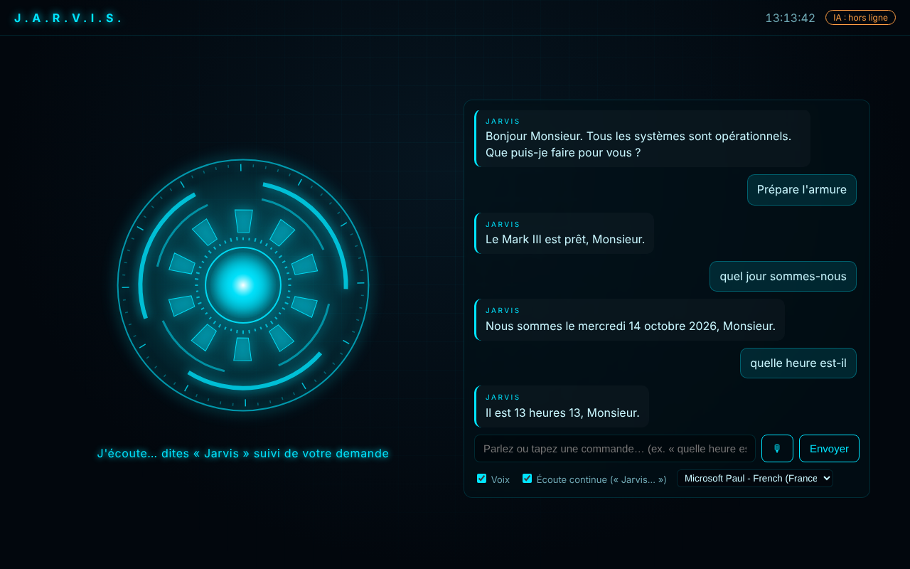

# J.A.R.V.I.S. – clone maison

Un assistant vocal inspiré de Jarvis (Iron Man) : fond sombre et cyan, **arc reactor animé**, **micro en français**, **voix de Jarvis**, **réponses IA (Claude)** et commandes locales (heure, date, minuteur, Google, YouTube).

Aucune dépendance npm : un serveur Node de 150 lignes et du JavaScript natif côté navigateur.



## Lancer

```bash
cd jarvis-clone
node server.js                                  # mode hors ligne (commandes + petites réponses)
ANTHROPIC_API_KEY=sk-ant-... node server.js     # avec l'IA Claude
```

Ouvrez **http://localhost:3000** dans **Chrome ou Edge**. La reconnaissance vocale a besoin de HTTPS ou de `localhost`. Firefox n'a pas `SpeechRecognition` : seule la saisie au clavier y fonctionne.

Variables : `PORT` (3000 par défaut), `ANTHROPIC_API_KEY`, `JARVIS_MODEL` (`claude-sonnet-5-5` par défaut).

## Utilisation

- **Touchez le réacteur**, le bouton 🎙 ou la touche **Espace**, puis parlez. **Échap** coupe la voix et le micro.
- **Écoute continue** : Jarvis n'écoute que les phrases qui contiennent « Jarvis… ».
- Exemples :
  - « Quelle heure est-il ? » / « Quel jour sommes-nous ? »
  - « Mets un minuteur de 5 minutes » / « Rappelle-moi dans 1 minute et 30 secondes » / « Arrête le minuteur »
  - « Cherche la météo à Paris sur Google »
  - « Mets Back in Black sur YouTube » / « Ouvre YouTube »
  - « Ouvre wikipedia.org », « Efface la conversation »
  - Tout le reste part à l'IA : « Explique-moi la fusion nucléaire en deux phrases ».

## Comment ça marche

| Brique | Fichier | Technique |
|---|---|---|
| Arc reactor | `public/reactor.js` | `<canvas>` redessiné à chaque `requestAnimationFrame` : halo en dégradé radial, graduations et arcs en rotation, 10 bobines trapézoïdales, cœur pulsant, `shadowBlur` pour la lueur. L'intensité suit le **volume réel du micro** (Web Audio `AnalyserNode`, valeur RMS) quand Jarvis écoute, et une **enveloppe simulée** quand il parle ou réfléchit. |
| Micro | `public/app.js` | Web Speech API `SpeechRecognition`, `lang = 'fr-FR'`, résultats intermédiaires affichés en direct. Le micro est coupé pendant que Jarvis parle, pour qu'il ne s'entende pas lui-même. En mode continu, l'écoute est relancée quand Chrome la coupe. |
| Voix | `public/app.js` | `speechSynthesis`. Choix automatique d'une **voix française masculine** (Paul, Henri, Thomas…), `pitch 0.85` pour une voix plus grave. Texte découpé en phrases, car Chrome coupe les énoncés de plus de 15 secondes. |
| Commandes | `public/commands.js` | Analyseur sans IA, avec normalisation des accents et de la ponctuation et nombres écrits en lettres (« une minute et trente secondes »). Il est testé sous Node. |
| IA | `server.js` | `POST /api/chat` → API Messages d'Anthropic, avec un *system prompt* « Jarvis, en français, réponses courtes, sans markdown ». La clé reste sur le serveur. Sans clé, des réponses de secours locales prennent le relais. |

## Tests

```bash
npm test                      # tests unitaires : analyseur + serveur
node server.js & node tests/e2e.js   # E2E Chromium (Playwright), micro et voix simulés
```

## Bugs trouvés et corrigés pendant les tests

1. « Mets **un minuteur** de 5 minutes » réglait 6 minutes : le « min » de « minuteur » était lu comme une unité après « un ». J'ai ajouté des limites de mot à l'expression régulière.
2. Une erreur de micro (`audio-capture`, `not-allowed`, `network`) était aussitôt remplacée par le message d'accueil dans `onend`. L'utilisateur ne voyait pas pourquoi le micro ne marchait pas. L'erreur reste maintenant affichée, sans relance en boucle.
3. En écoute continue, cliquer sur le micro pendant la courte pause entre deux relances le **rallumait** au lieu de l'éteindre, et pouvait lancer deux reconnaissances en même temps. L'état tient maintenant dans une seule variable (`reco`).
4. À minuit, Jarvis disait « Il est 0 heure ». Il dit désormais « minuit » (et « midi »).
5. Le navigateur bloque `window.open` après une commande vocale ou un appel réseau, faute de geste utilisateur. Un lien cliquable est donc toujours affiché en secours.

Voir [ANALYSE-REA.md](ANALYSE-REA.md) pour l'analyse REA.
